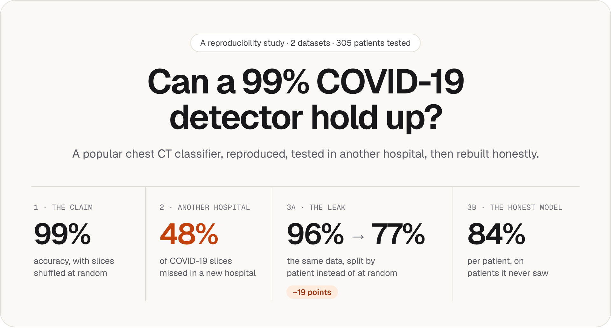
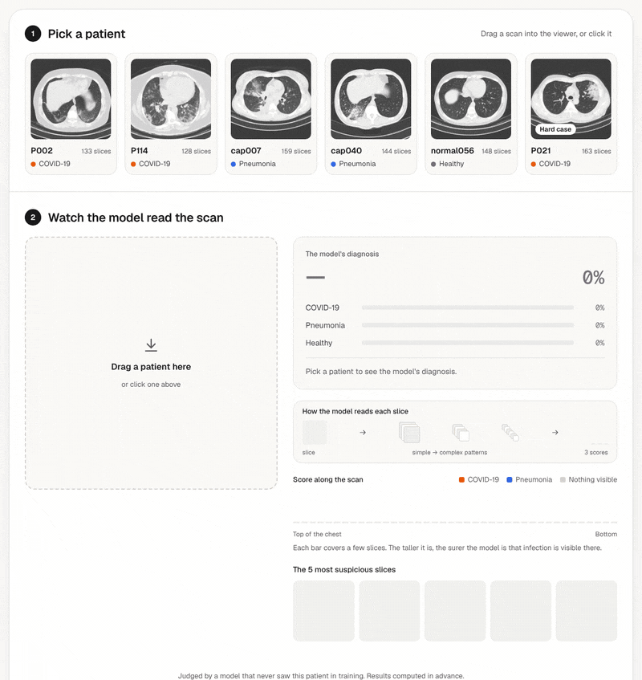
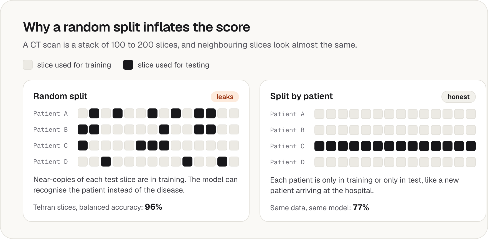
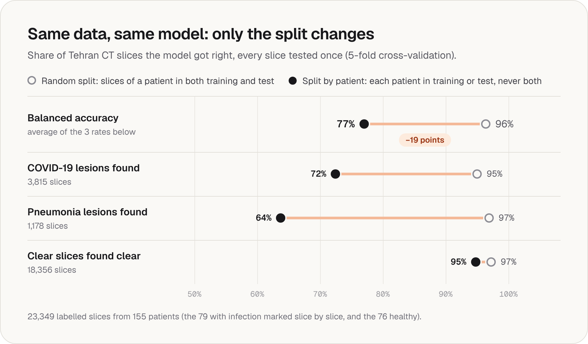
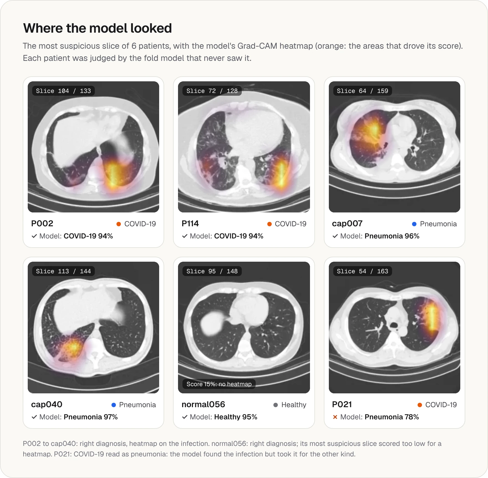
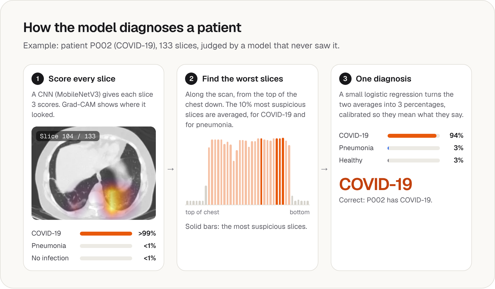
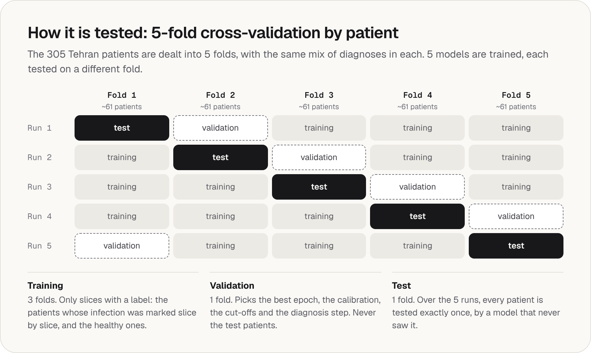

<div align="center">

<a href="https://zakyikow.github.io/covid_ct_diagnosis/">
  <picture>
    <source media="(prefers-color-scheme: dark)" srcset="assets/banner-dark.png">
    
  </picture>
</a>

[](https://zakyikow.github.io/covid_ct_diagnosis/)
[](https://github.com/zakyikow/covid_ct_diagnosis/actions/workflows/tests.yaml)


**[Try the live demo](https://zakyikow.github.io/covid_ct_diagnosis/)** &nbsp;·&nbsp;
[Story](#the-story-in-four-steps) ·
[Results](#results) ·
[How it works](#how-it-works) ·
[Structure](#project-structure) ·
[Limitations](#limitations) ·
[Reproduce](#reproduce)

</div>

<br>

Chest CT classifiers trained on a popular public dataset often report about **99% accuracy**. This project
reproduces one, tests it on patients from another hospital, measures how much of the 99% comes from a data leak,
then rebuilds the model honestly: each patient is either in training or in test, never both, and the model gives
one diagnosis per patient (**COVID-19**, **pneumonia** or **healthy**).

<p align="center">
  <a href="https://zakyikow.github.io/covid_ct_diagnosis/">
    
  </a>
  <br>
  <sub>The live demo: pick a patient, watch the model read the scan, then see its diagnosis and where it looked.
  The results were computed in advance; nothing runs in the browser.</sub>
</p>

## The story in four steps

| Step | Question | Answer | Key number |
|---|---|---|---|
| **1. Reproduce**<br>[`1_reproduce_baseline/`](1_reproduce_baseline/) | Does the popular model really reach 99%? | Yes, on the Wuhan dataset with its slices shuffled at random, as most public projects do: 21 mistakes on 2,953 test slices. | **99.3%**<br>accuracy |
| **2. Another hospital**<br>[`2_other_hospital_test/`](2_other_hospital_test/) | Does it still work on 305 patients from an imaging centre in Tehran? | No. It misses 1,824 of the 3,815 slices that radiologists marked as COVID-19, and it can't tell a COVID-19 lesion from a pneumonia lesion (AUROC 0.46, a coin flip). | **48%**<br>of COVID-19 slices missed |
| **3a. The leak**<br>[`3_honest_model/`](3_honest_model/) | How much of the score is the leak? | Same Tehran data, same model, same settings; only the split changes. Slices shuffled at random: 96%. Split by patient: 77%. | **−19 points**<br>balanced accuracy per slice |
| **3b. The honest model**<br>[`3_honest_model/`](3_honest_model/) | What is the real score, per patient? | One diagnosis per scan for all 305 Tehran patients, each judged by a model that never saw it in training. | **84%**<br>balanced accuracy per patient (95% CI 80–88%) |
| **4. The demo**<br>[`4_demo/`](4_demo/) | Can anyone see the honest model at work? | A web page where 6 Tehran patients are read and diagnosed, each by the model that never saw them. | **[Live demo](https://zakyikow.github.io/covid_ct_diagnosis/)** |

<picture>
  <source media="(prefers-color-scheme: dark)" srcset="assets/split-dark.png">
  
</picture>

The Wuhan dataset doesn't say which slices come from which patient, so its leak can't be measured directly. Step 3a
measures it on the Tehran dataset, which has patient IDs.

> **Balanced accuracy:** the share found correctly for each class, averaged, so a rare class counts as much as a
> common one. Plain accuracy hides failures on rare classes: in step 3a, 79% of the slices show no infection.<br>
> **AUROC:** the chance that a random case of one group scores higher than a random case of the other. 0.5 is a
> coin flip, 1 is perfect.

## Results

Every patient below is tested by a model that never saw it in training (5-fold cross-validation by patient, see
[how it works](#how-it-works)).

### 3a. The leak, measured

<picture>
  <source media="(prefers-color-scheme: dark)" srcset="assets/leak-dark.png">
  
</picture>

- **Every class drops, pneumonia the most** (97% → 64%): only 25 pneumonia patients have their infected slices
  marked, so with a random split the model most likely learns to recognise these few patients.
- **The gap is far larger than the noise:** 96.4 ± 1.2% vs. 77.3 ± 3.9% across the 5 folds.

### 3b. The honest model, patient by patient

| True diagnosis | Patients | Found | Rate |
|---|---:|---:|---:|
| COVID-19 | 169 | 130 | 77% |
| Pneumonia | 60 | 46 | 77% |
| Healthy | 76 | 75 | **99%** |
| **Balanced accuracy** | **305** | | **84%** (95% CI 80–88%) |

<table>
<tr><th align="left">True ↓ &nbsp; Model says →</th><th align="right">COVID-19</th><th align="right">Pneumonia</th><th align="right">Healthy</th></tr>
<tr><td><b>COVID-19</b> (169)</td><td align="right"><b>130</b></td><td align="right">22</td><td align="right">17</td></tr>
<tr><td><b>Pneumonia</b> (60)</td><td align="right">10</td><td align="right"><b>46</b></td><td align="right">4</td></tr>
<tr><td><b>Healthy</b> (76)</td><td align="right">1</td><td align="right">0</td><td align="right"><b>75</b></td></tr>
<tr><td><i>Right when it says so</i></td><td align="right"><i>92%</i></td><td align="right"><i>68%</i></td><td align="right"><i>78%</i></td></tr>
</table>

- **Healthy people are almost never flagged:** 75 of 76.
- **Most mistakes are COVID-19 patients** (39 of the 54):
  - **22 read as pneumonia:** the model found the infection but took it for the other kind, which can look alike
    on CT. Their most suspicious slices scored high for both (median 82% COVID-19, 85% pneumonia).
  - **17 read as healthy:** mostly mild cases. Their most suspicious slices scored a median 33% for COVID-19,
    against 96% for the COVID-19 patients it found.
- **Its percentages mean what they say:** 83% sure on average, right for 82% of patients.
- **Screening setting:** with a lower cut-off chosen on validation patients, it catches **158 of 169** COVID-19
  patients (93%), with 38 false alarms among the 136 others (28%).
- **Much better than the baseline on the same 305 patients:** COVID-19 vs. pneumonia AUROC 0.54 → 0.83, with the
  same scoring rule for both. Not a one-change comparison: the honest model was trained in Tehran and knows
  pneumonia.

### Heatmaps

<picture>
  <source media="(prefers-color-scheme: dark)" srcset="assets/heatmaps-dark.webp">
  
</picture>

<details>
<summary><b>More results</b>: per slice, per fold, steps 1 and 2, all plots</summary>

<br>

**Per slice, Tehran, the 5 test folds together** (23,349 labelled slices; 95% confidence intervals in brackets)

| | Random split | Split by patient |
|---|---:|---:|
| Balanced accuracy | 96.4% [95.2, 97.2] | 77.0% [72.3, 81.1] |
| Accuracy | 96.9% | 89.6% |
| COVID-19 lesions found | 95.0% | 72.5% |
| Pneumonia lesions found | 96.9% | 63.8% |
| Clear slices found clear | 97.3% | 94.8% |
| AUROC, COVID-19 slice vs. any other | 0.995 | 0.933 [0.908, 0.953] |
| AUROC, COVID-19 lesion vs. pneumonia lesion | 0.999 | 0.848 [0.785, 0.897] |

**Per fold** (each fold: about 61 test patients)

| Fold | 1 | 2 | 3 | 4 | 5 | Mean ± SD |
|---|---:|---:|---:|---:|---:|---:|
| Slice balanced accuracy, random split | 97.1% | 97.5% | 97.1% | 95.7% | 94.7% | 96.4 ± 1.2% |
| Slice balanced accuracy, by patient | 74.3% | 82.6% | 75.3% | 80.3% | 73.9% | 77.3 ± 3.9% |
| Patient balanced accuracy | 84.4% | 90.4% | 83.8% | 80.1% | 81.8% | 84.1 ± 3.9% |
| Patient AUROC, COVID-19 vs. pneumonia | 0.96 | 0.88 | 0.84 | 0.82 | 0.88 | 0.88 ± 0.05 |

**Compared with the step 2 baseline, same 305 patients, same scoring rule** (the mean of each patient's 10% most
suspicious slices)

| AUROC | Baseline (step 2) | Honest model |
|---|---:|---:|
| COVID-19 vs. healthy patients | 0.90 | 0.97 |
| COVID-19 vs. pneumonia patients | 0.54 | 0.83 |
| COVID-19 lesion vs. pneumonia lesion slices | 0.46 | 0.85 |

**Per patient, with the learned diagnosis** (instead of the shared scoring rule): AUROC COVID-19 vs. healthy 0.947,
vs. pneumonia 0.874, vs. both 0.915 [0.880, 0.945].

**Calibration, per patient:** error 0.17 before temperature scaling, 0.05 after.<br>
**Best epochs:** 6 to 15 with the random split, 3 to 7 split by patient: on unseen patients, the score stops
improving early while the training loss keeps falling.

**Step 1, Wuhan test slices:** balanced accuracy 99.2% [98.9, 99.6]. COVID-19 yes / no: 594 of 600 COVID-19 slices
found, no false alarm, AUROC 1.000.

**Step 2, Tehran:** at the usual 50% cut-off, 52% of the COVID-19 slices are found and 93% of the others are cleared.
59% of the pneumonia lesion slices (692 of 1,178) are called COVID-19. Per patient, AUROC COVID-19 vs. healthy 0.90,
vs. pneumonia 0.54, vs. both 0.74.

**Plots:**
[patient confusion matrix](3_honest_model/results/patient_split/plots/confusion_patients.png) ·
[patient ROC curves](3_honest_model/results/patient_split/plots/roc_patients.png) ·
[patient calibration](3_honest_model/results/patient_split/plots/calibration_patients.png) ·
[slice confusion matrix, by patient](3_honest_model/results/patient_split/plots/confusion_slices.png) ·
[slice confusion matrix, random](3_honest_model/results/random_split/plots/confusion_slices.png) ·
[step 2 ROC curves](2_other_hospital_test/results/all_patients/plots/roc_slices.png) ·
[step 1 confusion matrix](1_reproduce_baseline/results/plots/confusion_slices.png)

</details>

## How it works

<picture>
  <source media="(prefers-color-scheme: dark)" srcset="assets/pipeline-dark.png">
  
</picture>

<picture>
  <source media="(prefers-color-scheme: dark)" srcset="assets/folds-dark.png">
  
</picture>

<details>
<summary><b>Training details</b></summary>

<br>

- **Images:** 256 px grayscale. The Tehran DICOM scans are converted to Hounsfield units and shown with a lung
  window (centre −600, width 1500). Details in the [data card](0_data/README.md).
- **Model:** MobileNetV3-Large pretrained on ImageNet (`timm`), 3 classes per slice: no infection, COVID-19 lesion,
  pneumonia lesion.
- **Training:** random 224 px crops, flips, ±10° rotations, ±20% brightness and contrast. AdamW (learning rate 3e-4,
  weight decay 0.05), warm-up then cosine decay, class-weighted cross-entropy with label smoothing 0.05, up to 15
  epochs, keeping the epoch with the best validation balanced accuracy.
- **Folds:** balanced by diagnosis and by whether slice labels exist. The random twin deals slices instead of
  patients; everything else is identical. Training stops if a patient appears in two of training, validation and
  test.
- **Diagnosis:** a logistic regression with balanced class weights, fitted on each fold's validation patients.
- **Calibration:** temperature scaling, fitted on validation data only (slices, and out-of-fold predictions of the
  validation patients).
- **Confidence intervals:** 95%, from 1,000 resamples of the test patients.
- **Heatmaps:** Grad-CAM on the last feature map (7 × 7 for a 224 px slice), resized to the slice.

</details>

## Project structure

| Folder | What's inside |
|---|---|
| [`0_data/`](0_data/) | data card, and a notebook to explore both datasets |
| [`1_reproduce_baseline/`](1_reproduce_baseline/) | step 1: the 99% baseline |
| [`2_other_hospital_test/`](2_other_hospital_test/) | step 2: the baseline tested in Tehran |
| [`3_honest_model/`](3_honest_model/) | steps 3a and 3b: random split vs. split by patient (the leak), and the honest model |
| [`4_demo/`](4_demo/) | step 4: the demo page and its data |
| [`src/covid_ct_diagnosis/`](src/covid_ct_diagnosis/) | the code shared by every step |
| [`scripts/`](scripts/) | one command per step |
| [`tests/`](tests/) | 28 automatic tests: folds, no leakage, metrics, a tiny full run |

Each numbered folder has its own short README.

**Built with:** Python, PyTorch, timm, scikit-learn, pandas, pydicom, matplotlib, pytest, ruff · React, TypeScript,
Vite, Tailwind CSS, Motion · GitHub Actions and GitHub Pages.

## Limitations

- **One site for the honest model.** Its 84% comes from patients of the same Tehran imaging centre it was trained
  on. It has not been tested on a new hospital, which is exactly where the baseline broke.
- **Scan dates differ by diagnosis.** All Tehran scans come from one scanner, but the COVID-19 scans are from 2020,
  the pneumonia scans from 2018–2019 and the healthy scans from 2019–2020. Changes in settings over time could help
  the model separate the classes without looking at the lungs, which would inflate the score. Not tested here.
- **Few labelled pneumonia patients.** Only 25 have their infected slices marked, so pneumonia lesions are the
  weakest slice class, and each validation fold holds only about 5 of them.
- **Noisy slice labels.** Some slices labelled "no infection" show clear lesions. This affects training and the
  per-slice numbers, not the 84%, which is measured against each patient's recorded diagnosis.
- **2D slices only.** Each slice is read on its own; the diagnosis only combines their scores.

## Reproduce

Needs macOS or Linux, Python 3.10+, a [Kaggle API token](https://www.kaggle.com/settings) saved in
`~/.kaggle/access_token`, and about 30 GB of free disk space during step 0 (18 GB once the downloaded zip is
deleted). The Apple GPU (MPS) or an NVIDIA GPU is used when present. Step 3 trains 10 models and is by far the
longest step.

```bash
bash scripts/run.sh step0           # install, download both datasets (~14 GB), convert them
bash scripts/run.sh step1           # reproduce the 99% model
bash scripts/run.sh step2           # test it on the Tehran patients
bash scripts/run.sh step3_random    # 3a: Tehran, random split, 5-fold cross-validation
bash scripts/run.sh step3_patient   # 3a + 3b: Tehran, split by patient: the honest model
bash scripts/run.sh step4           # demo data: 6 patients, each through its own fold's model
bash scripts/run.sh report          # one table with every result, in results.md
bash scripts/run.sh notebook        # open the notebook that explores both datasets
bash scripts/run.sh test            # automatic tests, no data needed
```

Every step can be run again: finished parts are skipped, and an interrupted cross-validation resumes at the next
fold.

**Skip the training.** The [release](https://github.com/zakyikow/covid_ct_diagnosis/releases) holds the 5 trained
fold models of the honest model with their predictions. After step 0, unzip them into
`3_honest_model/results/patient_split/` to run step 4 or the Grad-CAM figure without training:

```bash
unzip honest_model.zip -d 3_honest_model/results/patient_split/
bash scripts/run.sh step4
.venv/bin/python -m covid_ct_diagnosis.explain gradcam \
    --model-dir 3_honest_model/results/patient_split
```

**The demo page** needs Node.js 22 or newer. From `4_demo/`:

```bash
npm install    # once
npm run dev    # the page on a local address, reloaded on every change
npm run build  # the finished page, in 4_demo/dist/
```

It is published to GitHub Pages by `.github/workflows/deploy_demo.yaml` at every push to `main`.

## Data and credits

| | Wuhan dataset (iCTCF) | Tehran dataset (COVID-CT-MD) |
|---|---|---|
| Source | 2 hospitals in Wuhan, China | 1 imaging centre in Tehran, Iran (one scanner) |
| Content | 19,685 single slices | 305 full scans (45,471 slices): 169 COVID-19, 60 pneumonia, 76 healthy |
| Patient IDs | **no** (about 104 patients) | **yes** |
| Used in | step 1 | steps 2, 3 and 4 |

- **Wuhan (iCTCF):** Ning W. et al., *Open resource of clinical data from patients with pneumonia for the prediction
  of COVID-19 outcomes via deep learning*, Nature Biomedical Engineering, 2020. Used through the Kaggle dataset
  [`azaemon/preprocessed-ct-scans-for-covid19`](https://www.kaggle.com/datasets/azaemon/preprocessed-ct-scans-for-covid19)
  (CC BY 4.0).
- **Tehran (COVID-CT-MD):** Afshar P. et al., *COVID-CT-MD, COVID-19 computed tomography scan dataset applicable in
  machine learning and deep learning*, Scientific Data, 2021. Scans from
  [figshare](https://doi.org/10.6084/m9.figshare.12991592) (CC0), slice labels from
  [ShahinSHH/COVID-CT-MD](https://github.com/ShahinSHH/COVID-CT-MD).
- **The baseline** follows the approach of
  [chrispathway/covid-ct-classifier](https://github.com/chrispathway/covid-ct-classifier). Many public projects on
  this dataset report the same ~99%: the issue comes from the dataset having no patient IDs, not from any one
  project.
- **An independent audit** of the same baseline:
  [PopcornKitsilano/covid-ct-audit](https://github.com/PopcornKitsilano/covid-ct-audit).

No scans are stored in this repository, except slices of the 6 demo patients, in `4_demo/public/data/` and in the
README images (COVID-CT-MD, CC0).

<br>

<p align="center"><sub>A personal research project. Not a medical device.</sub></p>
